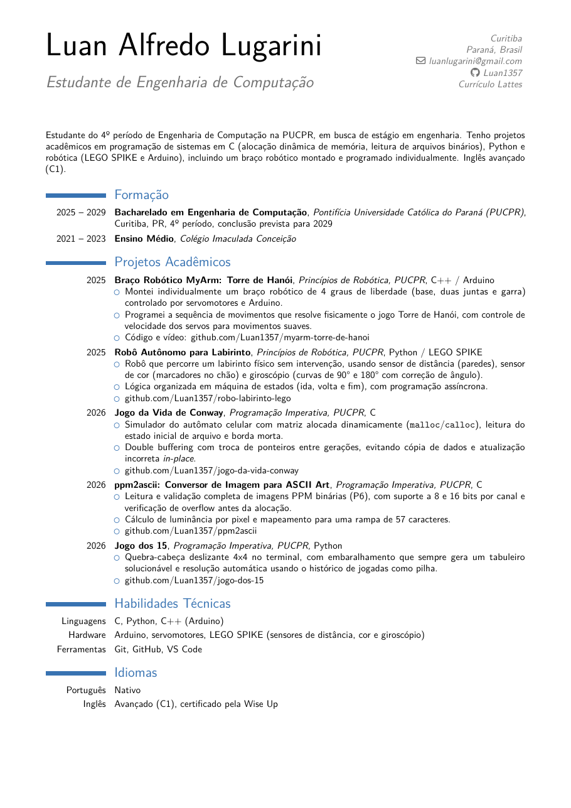
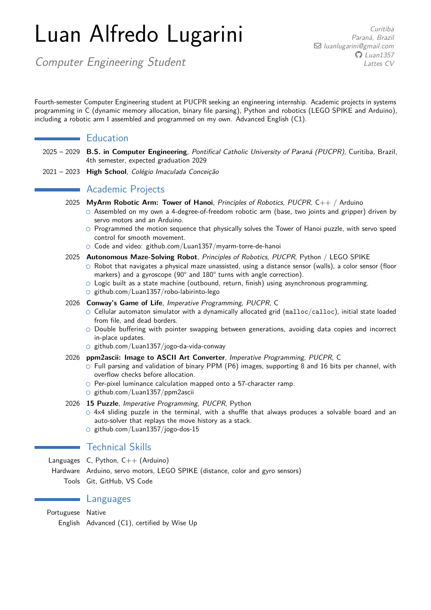

# Currículo | Luan Alfredo Lugarini

Currículo em LaTeX (classe `moderncv`), em português e inglês.

| Versão | PDF |
| --- | --- |
| Português | [LuanLugariniCV_PT.pdf](LuanLugariniCV_PT.pdf) |
| English | [LuanLugariniCV_EN.pdf](LuanLugariniCV_EN.pdf) |

<p>
  
  
</p>

## Como compilar

Precisa de uma distribuição LaTeX com o pacote `moderncv` (TeX Live ou MiKTeX).

```bash
./build.sh      # Linux / macOS
run.bat         # Windows
```

## Créditos

Template baseado em [Ricardo-Mutti/SoftwareEngineerCV](https://github.com/Ricardo-Mutti/SoftwareEngineerCV), sob licença MIT (ver [LICENSE](LICENSE)).
